# Material Mascot

[](https://opensource.org/licenses/MIT)
[](https://android-arsenal.com/api?level=26)

A living bot avatar for Compose Multiplatform — **Android and desktop (JVM)**. Everything is drawn at runtime, with no image assets. The bot has no mouth: it emotes through eye shape, body squash, motion and small props.

The drawing is done by **[`mascot-core`](mascot-core/README.md)**, a Rust crate in this repository with no dependencies, no heap and `no_std`, so the same mascot also runs on a microcontroller or in WebAssembly. This Kotlin library is a thin wrapper around it: it keeps the state machine, asks the core for a frame over JNI, and shows it in a Compose `Canvas`. The `live` package (mood bus, stage claim, shake-to-dizzy) is plain Kotlin; only the shake sensor is Android-specific.

The project began as a Kotlin port of **bloub**, the MIT-licensed SVG recreation of the x.ai Grok avatar.

<p align="center">
  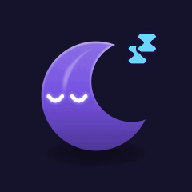
</p>

<p align="center">
  
  
  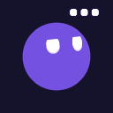
  
  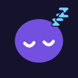
  
  
</p>

## Features

- **Zero assets**: every body is a signed distance field, so any shape morphs into any other
- **49 states**: 23 emotions, 18 objects, and the 8 original shape morphs — see the [gallery](#state-gallery)
- **7 finishes**: `FLAT`, `CHROME`, `OUTLINE`, `CLAY`, `NEON`, `PIXEL`, `LED` — same shapes and animation, different paint
- **8 eye personalities**: `GROK`, `CLASSIC`, `BIG`, `ROUND`, `PUPIL`, `BLOCK`, `VIZOR`, `DOT`
- **Deterministic animation**: a pure function of time — pause, resume, seek and slow-mo produce identical frames
- **Life at rest**: gaze that holds and jumps, and blinking
- **Living-companion mode**: app-wide mood bus, shake-to-dizzy sensor reaction, single big-companion stage claim (`live` package)
- **Reduced motion**: `motion = false` turns off idle gaze wander and blinking
- **Tap interaction**: tap the bot and it lights up (Happy state for ~1.1 s)

## Requirements

| | |
|---|---|
| Targets | `androidTarget()`, `jvm("desktop")` |
| Min SDK (Android) | 26 |
| Compile SDK (Android) | 36 |
| Kotlin | 2.2.0+ |
| Compose Multiplatform | 1.9.3+ (Foundation/UI, Material3) |
| To build from source | Rust (`cargo`); for Android also the NDK and `cargo-ndk`. See [Building Locally](#building-locally). |

## Setup

Coordinates: `com.maxmaster.materialmascot:mascot:1.0.0`

Until the artifact is on a remote repository, publish it locally once and consume it via `mavenLocal()`:

```bash
git clone https://github.com/maxmaster/material-mascot.git
cd material-mascot
./gradlew :mascot:publishToMavenLocal
```

```kotlin
// settings.gradle.kts
dependencyResolutionManagement {
    repositories {
        google()
        mavenCentral()
        mavenLocal()          // picks up com.maxmaster.materialmascot:mascot
    }
}
```

```kotlin
// build.gradle.kts (Android-only consumer)
dependencies {
    implementation("com.maxmaster.materialmascot:mascot:1.0.0")
}
```

From a Kotlin Multiplatform consumer, depend on it per source set instead — put `ShakeDizzyController`/`ShakeDizzyEffect` calls behind `androidMain`, everything else is safe in `commonMain`:

```kotlin
// build.gradle.kts (KMP consumer)
kotlin {
    sourceSets {
        commonMain.dependencies {
            implementation("com.maxmaster.materialmascot:mascot:1.0.0")
        }
    }
}
```

A plain desktop entry point needs nothing beyond the usual Compose Multiplatform `application {}` boilerplate:

```kotlin
// desktopMain
fun main() = application {
    Window(onCloseRequest = ::exitApplication) {
        MaterialBot(config = MascotConfig())
    }
}
```

Or via version catalog (`gradle/libs.versions.toml`):

```toml
[versions]
materialMascot = "1.0.0"

[libraries]
material-mascot = { module = "com.maxmaster.materialmascot:mascot", version.ref = "materialMascot" }
```

## Usage

### The one-liner

`MascotConfig()` is fully defaulted: a 64 dp, near-black, idle bot that breathes, blinks and looks around on its own.

```kotlin
import androidx.compose.runtime.Composable
import com.maxmaster.materialmascot.config.MascotConfig
import com.maxmaster.materialmascot.ui.MaterialBot

@Composable
fun Mascot() {
    MaterialBot(config = MascotConfig())
}
```

### Colour, size, eye style, finish

```kotlin
import androidx.compose.runtime.Composable
import androidx.compose.ui.graphics.Color
import androidx.compose.ui.unit.dp
import com.maxmaster.materialmascot.config.MascotConfig
import com.maxmaster.materialmascot.config.MascotFinish
import com.maxmaster.materialmascot.engine.BotState
import com.maxmaster.materialmascot.engine.EyeStyle
import com.maxmaster.materialmascot.ui.MaterialBot

@Composable
fun BlueReader() {
    MaterialBot(
        config = MascotConfig(
            state = BotState.Reading,
            color = Color(0xFF2496E8),        // body ink
            eyeColor = Color.White,           // eyes, and dots painted on the body
            size = 120.dp,
            eyeStyle = EyeStyle.BIG,
            finish = MascotFinish.CHROME
        )
    )
}
```

`eyeStyle` reshapes the plain eye of each state; expression shapes (hearts, happy arcs, chevrons) keep their meaning. For full control over shading and accent colours pass a `palette` instead of `color`/`eyeColor`: `MascotPalette.Grape`, `Ink`, `Ember`, `Mint`, `Handheld`, or your own.

### Driving state from your own app state

`MascotConfig` is `@Immutable` and host-owned: map your UI state to a `BotState` and rebuild the config. Every change is a smooth morph — no animation calls of your own.

```kotlin
import androidx.compose.runtime.Composable
import androidx.compose.ui.unit.dp
import com.maxmaster.materialmascot.config.MascotConfig
import com.maxmaster.materialmascot.engine.BotState
import com.maxmaster.materialmascot.ui.MaterialBot

sealed interface ChatUiState {
    data object Idle : ChatUiState
    data object Listening : ChatUiState
    data object Thinking : ChatUiState
    data class Replying(val text: String) : ChatUiState
    data class Failed(val cause: Throwable) : ChatUiState
}

@Composable
fun ChatBot(uiState: ChatUiState) {
    val state: BotState = when (uiState) {
        ChatUiState.Idle -> BotState.Idle
        ChatUiState.Listening -> BotState.Listening
        ChatUiState.Thinking -> BotState.Thinking
        is ChatUiState.Replying -> BotState.Responding
        is ChatUiState.Failed -> BotState.Alert
    }

    MaterialBot(
        config = MascotConfig(state = state, size = 96.dp),
        contentDescription = "Chat companion"
    )
}
```

Note the explicit `BotState` type: `BotState.Idle` on its own infers the singleton's own type, which then cannot hold `BotState.Listening`. Same for state you hold yourself — `remember { mutableStateOf<BotState>(BotState.Idle) }`.

### The bot as a button

`onClick` runs in addition to the built-in poke reaction (a moment of Happy), so the bot can carry a real action without losing the delight of prodding it. Leave it `null` and the bot stays decorative.

```kotlin
import androidx.compose.runtime.Composable
import androidx.compose.ui.unit.dp
import com.maxmaster.materialmascot.config.MascotConfig
import com.maxmaster.materialmascot.engine.BotState
import com.maxmaster.materialmascot.ui.MaterialBot

@Composable
fun AssistantButton(onOpenAssistant: () -> Unit) {
    MaterialBot(
        config = MascotConfig(state = BotState.Greet, size = 72.dp),
        contentDescription = "Open assistant",
        onClick = onOpenAssistant
    )
}
```

### Accessibility

`contentDescription` adds a semantics node with that label; `null` (the default) omits it entirely, which is what a purely decorative bot next to text that already says the same thing should do. `motion = false` turns off idle life (gaze wander and blinking); the state's own animation still plays.

```kotlin
import android.provider.Settings
import androidx.compose.runtime.Composable
import androidx.compose.runtime.remember
import androidx.compose.ui.platform.LocalContext
import com.maxmaster.materialmascot.config.MascotConfig
import com.maxmaster.materialmascot.engine.BotState
import com.maxmaster.materialmascot.ui.MaterialBot

@Composable
fun NarratorBot(isNarrating: Boolean) {
    val context = LocalContext.current
    val animationsOn = remember(context) {
        Settings.Global.getFloat(
            context.contentResolver,
            Settings.Global.ANIMATOR_DURATION_SCALE,
            1f
        ) != 0f
    }

    MaterialBot(
        config = MascotConfig(
            state = if (isNarrating) BotState.Narrating else BotState.Idle,
            motion = animationsOn
        ),
        contentDescription = if (isNarrating) "Narrator, reading aloud" else "Narrator, idle"
    )
}
```

## State Gallery

Every state in the default finish, recorded from the Rust core. Any state morphs into any other in half a second.

### Conversation

|  |  |  |  | 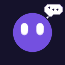 |  |  |
|:-:|:-:|:-:|:-:|:-:|:-:|:-:|
| `Idle` | `Listening` | `Thinking` | `Working` | `Responding` | `Narrating` | `Reading` |

| 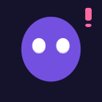 | 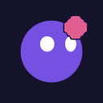 |
|:-:|:-:|
| `Alert` | `Notify` |

### Emotions

|  |  | 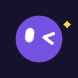 |  |  |  | 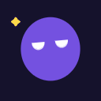 |
|:-:|:-:|:-:|:-:|:-:|:-:|:-:|
| `Happy` | `Smile` | `Wink` | `Laugh` | `Excited` | `Love` | `Proud` |

|  | 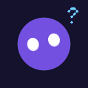 | 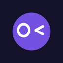 |  |  | 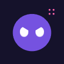 | 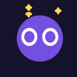 |
|:-:|:-:|:-:|:-:|:-:|:-:|:-:|
| `Greet` | `Confused` | `Silly` | `Sad` | `Sleepy` | `Angry` | `Dizzy` |

### Objects

|  |  |  | 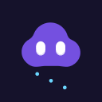 |  |  | 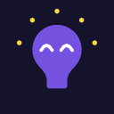 |
|:-:|:-:|:-:|:-:|:-:|:-:|:-:|
| `Heart` | `Star` | `Droplet` | `Cloud` | `Ghost` | `Bubble` | `Bulb` |

| 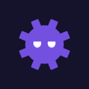 | 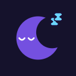 |  |  |  | 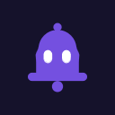 | 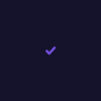 |
|:-:|:-:|:-:|:-:|:-:|:-:|:-:|
| `Gear` | `Moon` | `Flame` | `Bolt` | `Diamond` | `Bell` | `Check` |

|  |  |  | 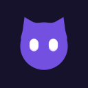 |
|:-:|:-:|:-:|:-:|
| `Cross` | `Magnifier` | `Hourglass` | `Cat` |

`Bubble`, `Bolt`, `Check`, `Cross`, `Magnifier` and `Hourglass` have no face.

### Shape morphs

|  | 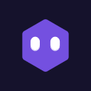 |  |  | 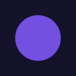 |  |  |  |
|:-:|:-:|:-:|:-:|:-:|:-:|:-:|:-:|
| `Egg` | `Hexagon` | `Play` | `Exclaim` | `Burst` | `Comet` | `Orbit` | `Swirl` |

`Burst` and `Comet` shrink the ball to a pebble and grow it back on a loop.

## Finishes

`MascotFinish` changes only the paint — shapes, poses and timing are identical.

| 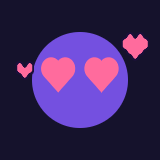 | 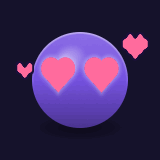 | 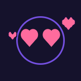 | 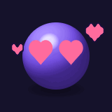 | 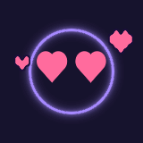 | 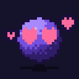 |  |
|:-:|:-:|:-:|:-:|:-:|:-:|:-:|
| `FLAT` | `CHROME` | `OUTLINE` | `CLAY` | `NEON` | `PIXEL` | `LED` |

| Finish | Look |
|---|---|
| `FLAT` | One solid fill with smooth edges. Default. |
| `CHROME` | Body lit from above, rim light, a soft highlight, a ground shadow, and bloom around the eyes (skipped when the eyes are not brighter than the body). |
| `OUTLINE` | Line art: the body stroked and never filled, eyes in the same ink. Reads on any background. |
| `CLAY` | Smooth 3D shading. |
| `NEON` | Line art with a glow. |
| `PIXEL` | Pixel art on a `pixelGrid`-cell grid, shaded per `pixelShade` (`LIT`, `SOFT`, `FLAT`). |
| `LED` | The pixel grid shown as round dots. |

```kotlin
MascotConfig(finish = MascotFinish.OUTLINE, color = MaterialTheme.colorScheme.onSurface)
```

## MascotConfig

| Field | Type | Default | Meaning |
|---|---|---|---|
| `enabled` | `Boolean` | `true` | Whether the mascot is visible. `false` composes nothing. |
| `state` | `BotState` | `BotState.Idle` | Current emotional/operational state; changing it morphs. |
| `initialState` | `BotState` | `BotState.Idle` | State shown on first composition, before any state change. |
| `color` | `Color` | `Color(0xFF0A0A0C)` | Body colour. Shading tones are derived from it. Ignored when `palette` is set. |
| `eyeColor` | `Color` | `Color.White` | Eye colour. Ignored when `palette` is set. |
| `size` | `Dp` | `64.dp` | Canvas size. |
| `motion` | `Boolean` | `true` | `false` turns off idle gaze wander and blinking. |
| `energy` | `Float` | `1.9f` | Kept for source compatibility; the Rust core has one fixed liveliness, so this currently has no effect. |
| `eyeStyle` | `EyeStyle` | `EyeStyle.GROK` | Eye personality. |
| `finish` | `MascotFinish` | `MascotFinish.FLAT` | How the bot is painted. |
| `cat` | `Boolean` | `false` | Cat ears on the resting ball. |
| `palette` | `MascotPalette?` | `null` | Full colour set; `null` derives one from `color` and `eyeColor`. |
| `pixelGrid` | `Int` | `32` | Cells across for `PIXEL` and `LED`. |
| `pixelShade` | `PixelShade` | `LIT` | Body shading for `PIXEL` and `LED`. |
| `maxFps` | `Int` | `30` | Upper bound on repaints per second; `0` repaints every display frame. |
| `maxRenderPx` | `Int` | `256` | Upper bound on the rendered frame's side in pixels. A larger bot is rendered at this size and scaled up. |

`size` is the layout box the composable occupies, and nothing is drawn outside it. The ball is 60% of the box across, which leaves room inside for props such as the Zzz, the badge and the speech bubble.

## MaterialBot

```kotlin
@Composable
public fun MaterialBot(
    config: MascotConfig,
    modifier: Modifier = Modifier,
    contentDescription: String? = null,
    onClick: (() -> Unit)? = null
)
```

Animates autonomously off the frame clock. The frame is rendered in the draw phase, so a new frame invalidates only this canvas' draw and never triggers recomposition. If the native core cannot be loaded the bot degrades to a plain ball; `BotEngine.nativeError` says why.

## The Living Companion: LiveBot

[`LiveBot`](mascot/src/main/java/com/maxmaster/materialmascot/live/LiveBot.kt) wraps `MaterialBot` and adds app-wide life: exactly one place decides what the bot feels.

1. A hard shake always wins → Silly face + wobble.
2. An explicit `state` parameter overrides everything else.
3. Otherwise the shared **status bus** drives the mood — one `begin()` call moves *every* `LiveBot` on screen at once.

Install once at your activity root:

```kotlin
import com.maxmaster.materialmascot.live.*

class MainActivity : ComponentActivity() {
    override fun onCreate(savedInstanceState: Bundle?) {
        super.onCreate(savedInstanceState)
        setContent {
            // One controller per activity; buzz respects your own setting.
            val shakeBuzzEnabled = remember { mutableStateOf(true) }
            val shakeDizzy = remember {
                ShakeDizzyController(this, vibrationEnabled = { shakeBuzzEnabled.value })
            }
            ShakeDizzyEffect(shakeDizzy)

            val statusBus = remember { MascotStatusBus() }

            CompositionLocalProvider(
                LocalShakeDizzy provides shakeDizzy,
                LocalMascotStatus provides statusBus,
            ) {
                App()
            }
        }
    }
}
```

Then render bots anywhere below that point:

```kotlin
LiveBot(
    config = MascotConfig(size = 96.dp),
    modifier = Modifier.align(Alignment.BottomEnd),
    contentDescription = "Companion",
    onClick = { openAssistant() }
)
```

Report real work through the bus and every visible companion reacts:

```kotlin
val token = statusBus.begin("chat")   // MascotStatus.WORKING -> BotState.Working
try {
    sendMessage()
    statusBus.success(token)          // transient SUCCESS -> Happy, cleared after 3.5 s
} catch (t: Throwable) {
    statusBus.error(token)            // transient ERROR -> Alert
}

// Long-running ops escalate on their own: WORKING -> SLOW (Sleepy) after 10 s.
// statusBus.cancel(token) drops the operation with no terminal state.
```

Operations are reference-counted and aggregated `ERROR > SUCCESS > SLOW > WORKING > IDLE`, so one short job cannot hide another that is still running. Both composition locals are nullable by design: where they are not provided, `LiveBot` degrades gracefully (no wobble, static config state).

### One Big Companion: BotStage

Screens that show their own large bot can claim the "big companion" slot so floating hosts and scaffolds hide their duplicate companion while the big one is visible:

```kotlin
import com.maxmaster.materialmascot.live.BotStage

@Composable
fun ChatScreen(bigBot: @Composable () -> Unit) {
    DisposableEffect(Unit) {
        val claim = BotStage.enter()
        onDispose { BotStage.exit(claim) }   // overlapping claims are ref-counted
    }
    if (BotStage.bigCompanionOnStage) bigBot()   // snapshot-backed: recomposes same frame
}
```

### Custom Renderers

Rendering `MaterialBot` yourself? You still get shake reactions à la carte:

```kotlin
val dizzy = LocalShakeDizzy.current
MaterialBot(
    config = MascotConfig(
        state = if (dizzy != null && dizzy.level.floatValue > DIZZY_FACE_THRESHOLD)
            BotState.Dizzy else myState
    ),
    modifier = Modifier.dizzyWobble(dizzy, enabled = motionAllowed)
)
```

For your own surface, drive [`BotEngine`](mascot/src/commonMain/kotlin/com/maxmaster/materialmascot/engine/BotEngine.kt) directly. `render` is a pure function of time that fills an `IntArray` with straight-alpha ARGB pixels:

```kotlin
val engine = BotEngine(BotState.Idle)
engine.setState(BotState.Happy, nowMs)

val pixels = IntArray(128 * 128)
engine.render(nowMs, 128, pixels, RenderStyle(finish = MascotFinish.CLAY, palette = MascotPalette.Grape))
```

## Eye Personality

```kotlin
MascotConfig(state = BotState.Idle, eyeStyle = EyeStyle.CLASSIC)
```

|  |  |  |  | 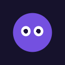 |  |  | 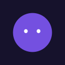 |
|:-:|:-:|:-:|:-:|:-:|:-:|:-:|:-:|
| `GROK` | `CLASSIC` | `BIG` | `ROUND` | `PUPIL` | `BLOCK` | `VIZOR` | `DOT` |

| Value | Look |
|---|---|
| `GROK` | Giant glossy ovals, set a little wider apart. Default. |
| `CLASSIC` | Tall capsules: the original measured look. |
| `BIG` | Classic, scaled up. |
| `ROUND` | Circles. |
| `PUPIL` | Wide whites with a dark pupil that follows the gaze. |
| `BLOCK` | Square-cornered. |
| `VIZOR` | Wide horizontal slits, robotic and deadpan. |
| `DOT` | Small beads. Drops lid expressions. |

## Palettes

```kotlin
MascotConfig(state = BotState.Happy, palette = MascotPalette.Ember)
```

|  | 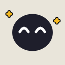 | 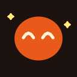 | 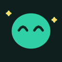 | 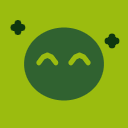 |
|:-:|:-:|:-:|:-:|:-:|
| `Grape` | `Ink` | `Ember` | `Mint` | `Handheld` |

Or build your own with `MascotPalette.fromBody(...)`, or just pass `color` and `eyeColor`.

## BotState Reference

All 49 states are listed in the [gallery](#state-gallery); each object's KDoc describes it. `BotState.all` holds them in that order. `BotState.fromName("thinking")` does a case-insensitive lookup and falls back to `Idle`.

Every state change morphs over `BotEngine.MORPH_MS` (500 ms). `posePeriodMs` is the length of a state's main loop; several states layer motions of different lengths, so treat it as the dominant rhythm rather than an exact tiling period.

**Changed from the first version:** `Happy` is now a two-eyed joyful hop (the wink moved to `Wink`), `Working` is its own pose instead of a copy of `Thinking`, and `LiveBot` shows `Dizzy` rather than `Silly` when shaken.

## Public API Surface

**config/** — `MascotConfig`, `MascotFinish`, `MascotPalette`
**ui/** — `MaterialBot`
**engine/** — `BotEngine`, `RenderStyle`, `PixelShade`, `BotState` (+49 objects), `EyeStyle`
**live/** — `LiveBot`, `MascotStatusBus`, `MascotStatus`, `MascotBusState`, `ShakeDizzyController`, `ShakeDizzyEffect`, `dizzyWobble`, `DIZZY_FACE_THRESHOLD`, `BotStage`, `LocalMascotStatus`, `LocalShakeDizzy`

The geometry types of the first version (`BotFrame`, `RenderedEye`, `NotifBadge`, `DotSpec`, `ArcSpec`, `BotEngine.sample`) are gone: geometry now lives in the Rust core, and `BotEngine.render` returns finished pixels. The `sample` package is `internal`.

## ProGuard / R8

Consumer rules ship inside the AAR (`consumer-rules.pro`). They pin the public API surface and keep the one class whose native methods the Rust core binds by name. No androidx/coroutines keeps leak into your app.

## Building Locally

The Gradle build compiles the Rust core for you, so it needs `cargo` on the `PATH`. The Android build also needs the NDK, `cargo-ndk`, and the Android Rust targets:

```bash
cargo install cargo-ndk
rustup target add aarch64-linux-android armv7-linux-androideabi x86_64-linux-android
```

```bash
cargo test                              # the Rust core on its own
./gradlew :mascot:desktopTest           # Kotlin tests against the real core (desktop)
./gradlew :mascot:assembleRelease       # release AAR, with the core for arm64-v8a, armeabi-v7a, x86_64
./gradlew :mascot:publishToMavenLocal   # AAR + POM + sources + javadoc jars
```

The desktop jar carries the core for the machine it was built on only.

The animations in this README are recorded from the core: `tools/make-gifs.sh` regenerates them (needs ImageMagick).

## License

```
MIT License

Copyright (c) 2026 Max Master

Permission is hereby granted, free of charge, to any person obtaining a copy
of this software and associated documentation files (the "Software"), to deal
in the Software without restriction, including without limitation the rights
to use, copy, modify, merge, publish, distribute, sublicense, and/or sell
copies of the Software, and to permit persons to whom the Software is
furnished to do so, subject to the following conditions:

The above copyright notice and this permission notice shall be included in all
copies or substantial portions of the Software.

THE SOFTWARE IS PROVIDED "AS IS", WITHOUT WARRANTY OF ANY KIND, EXPRESS OR
IMPLIED, INCLUDING BUT NOT LIMITED TO THE WARRANTIES OF MERCHANTABILITY,
FITNESS FOR A PARTICULAR PURPOSE AND NONINFRINGEMENT. IN NO EVENT SHALL THE
AUTHORS OR COPYRIGHT HOLDERS BE LIABLE FOR ANY CLAIM, DAMAGES OR OTHER
LIABILITY, WHETHER IN AN ACTION OF CONTRACT, TORT OR OTHERWISE, ARISING FROM,
OUT OF OR IN CONNECTION WITH THE SOFTWARE OR THE USE OR OTHER DEALINGS IN THE
SOFTWARE.
```

Based on **bloub** (MIT) — SVG recreation of the x.ai Grok avatar.
