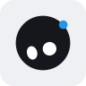
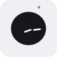
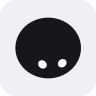
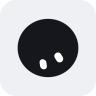
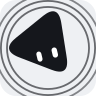
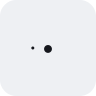
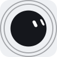
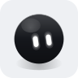

# Material Mascot

[](https://opensource.org/licenses/MIT)
[](https://android-arsenal.com/api?level=26)

A living bot avatar for Android / Jetpack Compose — a faithful Kotlin/Canvas port of **bloub**, the MIT-licensed SVG recreation of the x.ai Grok avatar. Everything is drawn at runtime — no image assets — as one filled silhouette with two capsule eyes, morphing between poses with measured, frame-by-frame-fitted geometry. The bot has no mouth: it emotes through eye shape, body squash and motion.

<p>
  
  
  
  
  
  
</p>

## Features

- **Zero assets**: single filled silhouette, 64-point radial profiles, capsule eyes on a sphere
- **26 states**: see the [gallery](#state-gallery) below
- **3 finishes**: `FLAT`, `CHROME`, `OUTLINE` — same silhouette and animation, different paint
- **Deterministic animation**: pure function of time — pause, resume, seek and slow-mo produce identical frames
- **Life at rest**: gaze drift, saccades, glances, blinks, micro-fidgets
- **5 eye personalities**: `CLASSIC`, `BIG`, `ROUND`, `DOT`, `VIZOR` — applied as a transform so expressions keep their character
- **Living-companion mode**: app-wide mood bus, shake-to-dizzy sensor reaction, single big-companion stage claim (`live` package, first-class public API)
- **Accessibility first**: `motion = false` kills decorative motion but keeps blinking/breathing essentials (WCAG reduced-motion)
- **Tap interaction**: tap the bot → it winks at you (Happy state for ~1.1 s)

## Requirements

| | |
|---|---|
| Min SDK | 26 |
| Compile SDK | 36 |
| Kotlin | 2.2.0+ |
| Compose (BOM era) | Foundation/UI 1.9+, Material3 |

## Setup

Coordinates: `com.maxmaster.materialmascot:mascot:1.0.0`

Until the artifact is on a remote repository, publish it locally once and consume it via `mavenLocal()`:

```bash
git clone https://github.com/maxmaster/material-mascot.git
cd material-mascot
./gradlew :mascot:publishToMavenLocal
```

```kotlin
// settings.gradle.kts
dependencyResolutionManagement {
    repositories {
        google()
        mavenCentral()
        mavenLocal()          // picks up com.maxmaster.materialmascot:mascot
    }
}
```

```kotlin
// build.gradle.kts
dependencies {
    implementation("com.maxmaster.materialmascot:mascot:1.0.0")
}
```

Or via version catalog (`gradle/libs.versions.toml`):

```toml
[versions]
materialMascot = "1.0.0"

[libraries]
material-mascot = { module = "com.maxmaster.materialmascot:mascot", version.ref = "materialMascot" }
```

## Usage

### The one-liner

`MascotConfig()` is fully defaulted: a 64 dp, near-black, idle bot that breathes, blinks and looks around on its own.

```kotlin
import androidx.compose.runtime.Composable
import com.maxmaster.materialmascot.config.MascotConfig
import com.maxmaster.materialmascot.ui.MaterialBot

@Composable
fun Mascot() {
    MaterialBot(config = MascotConfig())
}
```

### Colour, size, energy, eye style, finish

```kotlin
import androidx.compose.runtime.Composable
import androidx.compose.ui.graphics.Color
import androidx.compose.ui.unit.dp
import com.maxmaster.materialmascot.config.MascotConfig
import com.maxmaster.materialmascot.config.MascotFinish
import com.maxmaster.materialmascot.engine.BotState
import com.maxmaster.materialmascot.engine.EyeStyle
import com.maxmaster.materialmascot.ui.MaterialBot

@Composable
fun BlueReader() {
    MaterialBot(
        config = MascotConfig(
            state = BotState.Reading,
            color = Color(0xFF2496E8),        // body ink
            eyeColor = Color.White,           // eyes, and dots painted on the body
            size = 120.dp,
            energy = 1.2f,                    // 1.0 = measured calm, 1.9 = default
            eyeStyle = EyeStyle.BIG,
            finish = MascotFinish.CHROME
        )
    )
}
```

`energy` is clamped to `0.5f..2.5f` internally. `eyeStyle` reshapes whatever dimensions the current pose prescribes, so expressions keep their character (a Happy squint stays a squint).

### Driving state from your own app state

`MascotConfig` is `@Immutable` and host-owned: map your UI state to a `BotState` and rebuild the config. Every change is a smooth morph — no animation calls of your own.

```kotlin
import androidx.compose.runtime.Composable
import androidx.compose.ui.unit.dp
import com.maxmaster.materialmascot.config.MascotConfig
import com.maxmaster.materialmascot.engine.BotState
import com.maxmaster.materialmascot.ui.MaterialBot

sealed interface ChatUiState {
    data object Idle : ChatUiState
    data object Listening : ChatUiState
    data object Thinking : ChatUiState
    data class Replying(val text: String) : ChatUiState
    data class Failed(val cause: Throwable) : ChatUiState
}

@Composable
fun ChatBot(uiState: ChatUiState) {
    val state: BotState = when (uiState) {
        ChatUiState.Idle -> BotState.Idle
        ChatUiState.Listening -> BotState.Listening
        ChatUiState.Thinking -> BotState.Thinking
        is ChatUiState.Replying -> BotState.Responding
        is ChatUiState.Failed -> BotState.Alert
    }

    MaterialBot(
        config = MascotConfig(state = state, size = 96.dp),
        contentDescription = "Chat companion"
    )
}
```

Note the explicit `BotState` type: `BotState.Idle` on its own infers the singleton's own type, which then cannot hold `BotState.Listening`. Same for state you hold yourself — `remember { mutableStateOf<BotState>(BotState.Idle) }`.

### The bot as a button

`onClick` runs in addition to the built-in poke reaction (the wink), so the bot can carry a real action without losing the delight of prodding it. Leave it `null` and the bot stays decorative.

```kotlin
import androidx.compose.runtime.Composable
import androidx.compose.ui.unit.dp
import com.maxmaster.materialmascot.config.MascotConfig
import com.maxmaster.materialmascot.engine.BotState
import com.maxmaster.materialmascot.ui.MaterialBot

@Composable
fun AssistantButton(onOpenAssistant: () -> Unit) {
    MaterialBot(
        config = MascotConfig(state = BotState.Greet, size = 72.dp),
        contentDescription = "Open assistant",
        onClick = onOpenAssistant
    )
}
```

### Accessibility

`contentDescription` adds a semantics node with that label; `null` (the default) omits it entirely, which is what a purely decorative bot next to text that already says the same thing should do. `motion = false` drops decorative transitions and keeps only the life essentials (blink, gaze, breath).

```kotlin
import android.provider.Settings
import androidx.compose.runtime.Composable
import androidx.compose.runtime.remember
import androidx.compose.ui.platform.LocalContext
import com.maxmaster.materialmascot.config.MascotConfig
import com.maxmaster.materialmascot.engine.BotState
import com.maxmaster.materialmascot.ui.MaterialBot

@Composable
fun NarratorBot(isNarrating: Boolean) {
    val context = LocalContext.current
    val animationsOn = remember(context) {
        Settings.Global.getFloat(
            context.contentResolver,
            Settings.Global.ANIMATOR_DURATION_SCALE,
            1f
        ) != 0f
    }

    MaterialBot(
        config = MascotConfig(
            state = if (isNarrating) BotState.Narrating else BotState.Idle,
            motion = animationsOn
        ),
        contentDescription = if (isNarrating) "Narrator, reading aloud" else "Narrator, idle"
    )
}
```

## State Gallery

Static approximations drawn from each state's own pose geometry (`BotState.kt`), with life-at-rest and blinking switched off. On device they all breathe, drift and blink.

### Calm and attentive

| | | | | | |
|:-:|:-:|:-:|:-:|:-:|:-:|
|  |  |  |  |  |  |
| `Idle` | `Listening` | `Reading` | `Narrating` | `Responding` | `Proud` |

`Listening` is the widest pose in the set: eyes 0.36 x 0.88 ball-radius units, low on the body.

### Busy

| | |
|:-:|:-:|
|  |  |
| `Thinking` | `Working` |

Both hide the face and orbit three dots around the belly; `Working` is the alias for background work that is not user-facing "thinking".

### Warm and celebratory

| | | | | |
|:-:|:-:|:-:|:-:|:-:|
|  |  |  |  |  |
| `Happy` | `Smile` | `Greet` | `Love` | `Silly` |

`Happy` winks — one eye stays a capsule, the other becomes a dash. `Smile` closes both into mirrored arcs. The specks off `Greet`'s shoulder are the wave.

### Trouble and low energy

| | | | | | |
|:-:|:-:|:-:|:-:|:-:|:-:|
|  |  |  |  |  |  |
| `Alert` | `Exclaim` | `Notify` | `Confused` | `Sad` | `Sleepy` |

`Notify`'s badge is the one hardcoded colour in the library (`NOTIF_BLUE`, `0xFF2496E8`). `Sleepy`'s dot is the dream bubble, drifting up and popping every 2.8 s.

### Shape morphs

| | | | | | | |
|:-:|:-:|:-:|:-:|:-:|:-:|:-:|
|  |  |  |  |  |  |  |
| `Egg` | `Hexagon` | `Play` | `Orbit` | `Burst` | `Comet` | `Swirl` |

`Burst` and `Comet` are caught mid-collapse: both shrink the ball to a pebble and grow it back on a loop, so most of the cycle has no face. `Orbit` and `Swirl` are shown with their `ArcSpec` rings — those rings live in `BotFrame.arcs` for custom renderers; `MaterialBot` paints body, dots, eyes and badge only, so on device `Swirl` currently reads as a plain resting ball.

## Finishes

`MascotFinish` changes only the paint — silhouette, poses and timing are identical.

|  |  |  |
|:-:|:-:|:-:|
| `FLAT` | `CHROME` | `OUTLINE` |
| One solid fill in `color`, eyes in `eyeColor`. The reference look, and how the bot was measured. Default. | Gradient body (lit above, falling into shadow at the base), rim light, one upper-left specular highlight, a ground contact shadow, and bloom around the eyes. Every tone is derived from `color`, so a mint bot gets the same lit-metal treatment as a near-black one. | Line art: the body stroked and never filled, at `ball radius * 0.06` so the line keeps its weight at any `size`. Eyes are drawn in `color` too — with no fill behind them, `eyeColor` eyes would sit on the page instead of in the bot. Reads on any background, including photos and coloured cards. |

```kotlin
MascotConfig(finish = MascotFinish.OUTLINE, color = MaterialTheme.colorScheme.onSurface)
```

`CHROME` skips the eye bloom automatically when `eyeColor` is not meaningfully brighter than `color` — blooming a dark eye on a pale body only paints grey rings around it.

## MascotConfig

| Field | Type | Default | Meaning |
|---|---|---|---|
| `enabled` | `Boolean` | `true` | Whether the mascot is visible. `false` composes nothing. |
| `state` | `BotState` | `BotState.Idle` | Current emotional/operational state; changing it morphs. |
| `initialState` | `BotState` | `BotState.Idle` | State shown on first composition, before any state change. |
| `color` | `Color` | `Color(0xFF0A0A0C)` | Body fill (bloub's 'encre' ink); also the ink for eyes and stroke in `OUTLINE`. |
| `eyeColor` | `Color` | `Color.White` | Eye fill, and the fill of dots painted on the body. |
| `size` | `Dp` | `64.dp` | Canvas size. |
| `motion` | `Boolean` | `true` | `false` disables decorative transitions but keeps life (breath, gaze drift, blinking) per accessibility guidelines. |
| `energy` | `Float` | `1.9f` | Liveliness multiplier: `1.0` = measured calm of the reference video, `~1.6` = cheerful and active. Scales gaze drift speed, blink cadence, breathing and floating amplitude. Clamped to `0.5..2.5`. |
| `eyeStyle` | `EyeStyle` | `EyeStyle.CLASSIC` | Eye shape personality transform. |
| `finish` | `MascotFinish` | `MascotFinish.FLAT` | How the body is painted. `FLAT` renders identically to before this option existed. |

`size` is the layout box the composable occupies. The ball itself is drawn with radius `size * 100/158` around the centre — roughly 1.27x the box across — and is not clipped, so leave padding around a bot that sits next to other content.

## MaterialBot

```kotlin
@Composable
public fun MaterialBot(
    config: MascotConfig,
    modifier: Modifier = Modifier,
    contentDescription: String? = null,
    onClick: (() -> Unit)? = null
)
```

Animates autonomously off the frame clock. Sampling happens in the draw phase, so a new frame invalidates only this canvas' draw and never triggers recomposition.

## The Living Companion: LiveBot

[`LiveBot`](mascot/src/main/java/com/maxmaster/materialmascot/live/LiveBot.kt) wraps `MaterialBot` and adds app-wide life: exactly one place decides what the bot feels.

1. A hard shake always wins → Silly face + wobble.
2. An explicit `state` parameter overrides everything else.
3. Otherwise the shared **status bus** drives the mood — one `begin()` call moves *every* `LiveBot` on screen at once.

Install once at your activity root:

```kotlin
import com.maxmaster.materialmascot.live.*

class MainActivity : ComponentActivity() {
    override fun onCreate(savedInstanceState: Bundle?) {
        super.onCreate(savedInstanceState)
        setContent {
            // One controller per activity; buzz respects your own setting.
            val shakeBuzzEnabled = remember { mutableStateOf(true) }
            val shakeDizzy = remember {
                ShakeDizzyController(this, vibrationEnabled = { shakeBuzzEnabled.value })
            }
            ShakeDizzyEffect(shakeDizzy)

            val statusBus = remember { MascotStatusBus() }

            CompositionLocalProvider(
                LocalShakeDizzy provides shakeDizzy,
                LocalMascotStatus provides statusBus,
            ) {
                App()
            }
        }
    }
}
```

Then render bots anywhere below that point:

```kotlin
LiveBot(
    config = MascotConfig(size = 96.dp),
    modifier = Modifier.align(Alignment.BottomEnd),
    contentDescription = "Companion",
    onClick = { openAssistant() }
)
```

Report real work through the bus and every visible companion reacts:

```kotlin
val token = statusBus.begin("chat")   // MascotStatus.WORKING -> BotState.Working
try {
    sendMessage()
    statusBus.success(token)          // transient SUCCESS -> Happy, cleared after 3.5 s
} catch (t: Throwable) {
    statusBus.error(token)            // transient ERROR -> Alert
}

// Long-running ops escalate on their own: WORKING -> SLOW (Sleepy) after 10 s.
// statusBus.cancel(token) drops the operation with no terminal state.
```

Operations are reference-counted and aggregated `ERROR > SUCCESS > SLOW > WORKING > IDLE`, so one short job cannot hide another that is still running. Both composition locals are nullable by design: where they are not provided, `LiveBot` degrades gracefully (no wobble, static config state).

### One Big Companion: BotStage

Screens that show their own large bot can claim the "big companion" slot so floating hosts and scaffolds hide their duplicate companion while the big one is visible:

```kotlin
import com.maxmaster.materialmascot.live.BotStage

@Composable
fun ChatScreen(bigBot: @Composable () -> Unit) {
    DisposableEffect(Unit) {
        val claim = BotStage.enter()
        onDispose { BotStage.exit(claim) }   // overlapping claims are ref-counted
    }
    if (BotStage.bigCompanionOnStage) bigBot()   // snapshot-backed: recomposes same frame
}
```

### Custom Renderers

Rendering `MaterialBot` yourself? You still get shake reactions à la carte:

```kotlin
val dizzy = LocalShakeDizzy.current
MaterialBot(
    config = MascotConfig(
        state = if (dizzy != null && dizzy.level.floatValue > DIZZY_FACE_THRESHOLD)
            BotState.Silly else myState
    ),
    modifier = Modifier.dizzyWobble(dizzy, enabled = motionAllowed)
)
```

For a fully custom canvas, drive [`BotEngine`](mascot/src/main/java/com/maxmaster/materialmascot/engine/BotEngine.kt) directly: `sample(nowMs, scalePx, ...)` is a pure function returning a `BotFrame` of body points, eyes, dots, arcs and the badge.

## Eye Personality

```kotlin
MascotConfig(state = BotState.Idle, eyeStyle = EyeStyle.BIG)
```

| Value | Effect on the pose's own dimensions |
|---|---|
| `CLASSIC` | Unchanged: the measured reference look, tall capsules. Default. |
| `BIG` | `w * 1.55`, `h * 1.32` — the grokbots look, reads at a glance. |
| `ROUND` | `max(w, h) * 1.18` on both axes: curious cartoon mascot. |
| `DOT` | Fixed `0.085 x 0.085`: beady, understated, slightly mischievous. |
| `VIZOR` | `w * 1.7`, `h * 0.45` — wide horizontal slits, robotic and deadpan. |

## BotState Reference

| State | Description | Morph | Periodic |
|-------|-------------|-------|----------|
| `Idle` | Calm breathing ball (bob + slow swell) | 0.32s | 3.4s breath |
| `Listening` | Wide surprised eyes | 0.38s | Static |
| `Thinking` | 3 dots orbiting the belly, no face | 0.28s | 2.4s orbit |
| `Working` | Same animation as Thinking | 0.28s | 2.4s orbit |
| `Responding` | Lively ball, raised gaze | 0.32s | 0.8s bounce |
| `Alert` | Stretched ball vibrating at 2.5 Hz | 0.32s | 400ms buzz |
| `Happy` | Wink | 0.22s | Static |
| `Confused` | Mismatched mirrored tilts | 0.28s | Static |
| `Sleepy` | Small breathing ball + dream bubble | 0.5s | 2.8s cycle |
| `Notify` | Round eyes + blue badge pop | 0.35s | Static |
| `Narrating` | Reading aloud, lowered gaze | 0.32s | 1.1s bob |
| `Sad` | Droopy mirrored tilts, sigh rhythm | 0.35s | 3.2s cycle |
| `Love` | Round shining eyes, giddy sway | 0.28s | 1.4s sway |
| `Silly` | Crossed mismatched tilts, goofball | 0.3s | Static |
| `Egg` | Egg-shaped body | 0.4s | Static |
| `Hexagon` | Hexagonal body | 0.4s | Static |
| `Play` | Tumbling rounded triangle | 0.5s | 3s tumble |
| `Burst` | Collapse to pebble + spiral sparkles | 0.4s | 2.6s cycle |
| `Comet` | Shrink to comet dot + trail | 0.45s | 2.4s cycle |
| `Exclaim` | Upright "!" glyph | 0.45s | Static |
| `Orbit` | Triangle tumble + concentric rings | 0.6s | 3.4s cycle |
| `Swirl` | Compressed ring flourish | 0.35s | 1s cycle |
| `Smile` | Warm two-eyed smile arcs, body lifted | 0.26s | 3.2s breath |
| `Greet` | Lean-in hello hops + shoulder wave flick | 0.34s | 2.6s cycle |
| `Reading` | Eyes sweeping text lines, soft return | 0.32s | 2.6s sweep |
| `Proud` | Slow chest-up settle, warm half-lids | 0.6s | 3.6s breath |

`BotState.all` is exactly this list, in this order. `BotState.fromName("thinking")` does a case-insensitive lookup and falls back to `Idle`. The "Periodic" column is `posePeriodMs`: hosts that tile the animation (widget loop frames) sweep exactly that period so the wrap stays seamless.

## Public API Surface

**config/** — `MascotConfig`, `MascotFinish`
**ui/** — `MaterialBot`
**engine/** — `BotEngine`, `BotFrame`, `RenderedEye`, `NotifBadge`, `DotSpec`, `NotifSpec`, `ArcSpec`, `ORBIT_RINGS`, `BotState` (+26 objects), `EyeStyle`
**live/** — `LiveBot`, `MascotStatusBus`, `MascotStatus`, `MascotBusState`, `ShakeDizzyController`, `ShakeDizzyEffect`, `dizzyWobble`, `DIZZY_FACE_THRESHOLD`, `BotStage`, `LocalMascotStatus`, `LocalShakeDizzy`

Everything under `engine` that is geometry/math plumbing (`Pose`, `Silhouette`, `Face`, `HeadGaze`, `EyeCfg`, easings, PRNG) is `internal` and not part of the API contract. The `sample` package is `internal` too.

## ProGuard / R8

Consumer rules ship inside the AAR (`consumer-rules.pro`) and pin only the public API surface — no androidx/coroutines keeps leak into your app. Nothing here uses reflection, so R8 full mode works out of the box.

## Building Locally

```bash
./gradlew :mascot:testDebugUnitTest     # unit tests
./gradlew :mascot:assembleRelease       # release AAR -> mascot/build/outputs/aar/
./gradlew :mascot:publishToMavenLocal   # AAR + POM + sources + javadoc jars
```

## License

```
MIT License

Copyright (c) 2026 Max Master

Permission is hereby granted, free of charge, to any person obtaining a copy
of this software and associated documentation files (the "Software"), to deal
in the Software without restriction, including without limitation the rights
to use, copy, modify, merge, publish, distribute, sublicense, and/or sell
copies of the Software, and to permit persons to whom the Software is
furnished to do so, subject to the following conditions:

The above copyright notice and this permission notice shall be included in all
copies or substantial portions of the Software.

THE SOFTWARE IS PROVIDED "AS IS", WITHOUT WARRANTY OF ANY KIND, EXPRESS OR
IMPLIED, INCLUDING BUT NOT LIMITED TO THE WARRANTIES OF MERCHANTABILITY,
FITNESS FOR A PARTICULAR PURPOSE AND NONINFRINGEMENT. IN NO EVENT SHALL THE
AUTHORS OR COPYRIGHT HOLDERS BE LIABLE FOR ANY CLAIM, DAMAGES OR OTHER
LIABILITY, WHETHER IN AN ACTION OF CONTRACT, TORT OR OTHERWISE, ARISING FROM,
OUT OF OR IN CONNECTION WITH THE SOFTWARE OR THE USE OR OTHER DEALINGS IN THE
SOFTWARE.
```

Based on **bloub** (MIT) — SVG recreation of the x.ai Grok avatar.
